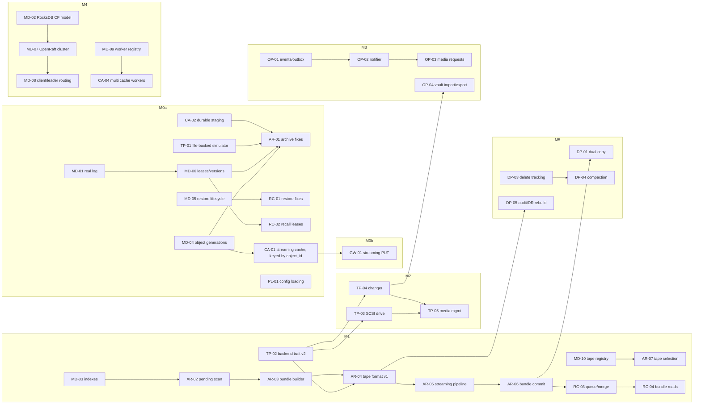

# ColdStore Development Roadmap (2026-11)

> **For agents:** read `AGENTS.md` first. Each task below is sized to be one PR (sometimes 2–3).
> Execute tasks in dependency order; never start a task whose `Depends on` items are not merged.

**Baseline:** commit `c205a5b`. The workspace builds and 116 tests pass. Three defects were confirmed
end-to-end:
- PUT > 2 MiB → 413.
- An overwritten key stays `COLD_PENDING` forever.
- Archived data is lost when the node restarts.

**Goal:** turn the Phase-1 prototype into the system described in `README.md`: an S3-compatible,
tape-backed cold archive with restore, cache, offline-tape workflows, data protection, and HA metadata.

## Plan index

| File | Component | Task prefix |
|---|---|---|
| `01-gateway.md` | S3 access layer (`coldstore-gateway`) | `GW-` |
| `02-metadata.md` | Metadata service, persistence, Raft (`coldstore-metadata`) | `MD-` |
| `03-scheduler-archive.md` | Archive scheduler (`coldstore-scheduler`) | `AR-` |
| `04-scheduler-recall.md` | Recall / restore scheduler (`coldstore-scheduler`) | `RC-` |
| `05-cache.md` | Staging + restored cache (`coldstore-cache`) | `CA-` |
| `06-tape.md` | Tape worker, drives, changers, media (`coldstore-tape`, `coldstore-vtl`) | `TP-` |
| `07-operations-notification.md` | Events, notifications, offline media, admin API/CLI/console | `OP-` |
| `08-data-protection-lifecycle.md` | Dual copy, scrub, delete/repack, audit, WORM, EC | `DP-` |
| `09-platform-observability.md` | Config, metrics, tracing, packaging, CI, testing, security | `PL-` |

## Milestones

Each milestone has a hard exit criterion. A milestone is **done only when its exit test runs
automatically** — in CI, or, while GitHub Actions are disabled in this repository (per the maintainer,
2026-11: no quota), in the container gate (`scripts/docker.sh check-safe`). The mhVTL lab job applies
for M2 either way. A test that only someone remembers to run does not close a milestone.

### Estimate reality (measured against the task list, 2026-11)

The week figures in each milestone heading are **elapsed calendar weeks for a small team**, not the
sum of the task estimates. Summing every `est.` in the nine plan files gives a different number:

| Milestone | Tasks | Sum of task estimates | Solo engineer | Heading claims | Optimism |
|---|---|---|---|---|---|
| M0 | 26 | 73–94 eng-days | ≈17 wk | 6–8 wk | **2.4×** |
| M1 | 28 | 108–132 eng-days | ≈24 wk | 8–10 wk | **2.7×** |
| M2 | 8 | 37–45 eng-days | ≈8 wk | 8–12 wk | 0.8× (has slack) |
| M3 | 9 | 31–38 eng-days | ≈7 wk | 5–7 wk | 1.2× |
| M4 | 18 | 82–102 eng-days | ≈18 wk | 10–14 wk | 1.5× |
| M5 | 9 | 46–57 eng-days | ≈10 wk | 10–14 wk | 0.9× (has slack) |
| M6 | 8 | 38–51 eng-days | ≈9 wk | 6–10 wk | 1.1× |

Readings: M0 and M1 are the two milestones whose headings cannot be met by one or two engineers —
they need three or four in parallel, and M0's critical path (`MD-04 → CA-01 → GW-01`,
`MD-01 → MD-06 → AR-01`) only supports about two people inside `coldstore-metadata` at a time. M2
and M5 are estimated honestly (M2 is hardware-bound anyway). Tasks tagged for two milestones are
counted in both, which inflates M1 and M6 slightly. `TP-12`, `DP-06` and `PL-10` carry open-ended
estimates and are excluded.

When planning a person-month, use the eng-day sums, not the headings.

Note on tags: the task headers in the nine plan files still say `[M0]`. That is correct for both
stages — the plan files do not distinguish M0-a from M0-b; this file is the only place that assigns a
task to a stage, and its scope tables are authoritative.

### M0: Trustworthy single node (≈ 6–8 engineer-weeks with 3 engineers; ≈ 17 solo)

**Theme:** no data loss, correct semantics, usable for objects up to 5 GiB on one machine with the
simulated library.

M0 is split into two stages with their own exit tests. As one milestone it was a single monolithic
gate: nothing could be proven end-to-end until every one of its P0 tasks had landed, because the only
exit test needed streaming, a persistent tape, generations, leases and the restore lifecycle at once.
M0-a delivers the data-integrity guarantees with the existing buffered request path; M0-b raises the
size ceiling and removes the buffering.

#### M0-a: Integrity and semantics (buffered bodies)

**Scope:**

| Area | Tasks |
|---|---|
| Gateway | GW-00, GW-09, GW-11, GW-12, GW-14a |
| Metadata | MD-01, MD-04, MD-05, MD-06 |
| Archive | AR-00, AR-01 |
| Recall | RC-01, RC-02, RC-10 |
| Cache | CA-01, CA-02, CA-03, CA-10a |
| Tape | TP-01 |
| Platform | PL-01, PL-02a, PL-04, PL-06a (e2e job) |

**Exit test** (`scripts/e2e/m0a.sh`, run by the gate):
1. Upload 1 KiB, 3 MiB and 128 MiB objects.
2. Overwrite one of them and delete one.
3. Wait for archive, then `kill -9` every process.
4. Restart and restore all objects; verify bytes and ETag.
5. Let one restore expire, restore it again, verify.

**Known interim limit:** bodies are still buffered in memory, so `DefaultBodyLimit` is raised from
axum's 2 MiB default to 128 MiB as an explicit, documented ceiling — peak gateway memory is
`concurrent PUTs × 128 MiB`. M0-b replaces this with streaming; do not treat 128 MiB as safe for
larger values.

Why the cache tasks are here and not in M0-b: `CA-02` (durable staging) is what makes the `kill -9`
step meaningful — without it an acknowledged PUT is lost, which is the defect M0 exists to close —
and `CA-01` keys staging by `object_id`, which `AR-01` depends on. `CA-01` lands with its streaming
methods and its own tests; the gateway starts calling them in M0-b.

#### M0-b: Streaming and the size ceiling

**Scope:**

| Area | Tasks |
|---|---|
| Gateway | GW-01, GW-02, GW-03 |

**Exit test** (`scripts/e2e/m0b.sh`): the M0-a test re-run with 300 MiB and 5 GiB objects streamed,
plus: gateway RSS stays under `chunk_size × concurrent_requests` (no whole-object `Vec<u8>`), and a
`Range` GET is served without reading the whole object. The cache already streams (CA-01); this stage
is the gateway adopting it and dropping the buffered path.

No step of either stage may leave an object stuck in a non-terminal state.

### M1: Tape-efficient archive and recall (≈ 8–10 engineer-weeks)

**Theme:** bundles instead of one-object-per-file, an on-tape format, merging, multiple drives,
throughput.

**Scope:**

| Area | Tasks |
|---|---|
| Archive | AR-02 … AR-08, AR-10, AR-11 |
| Recall | RC-03, RC-04, RC-05a, RC-06, RC-07, RC-09 |
| Tape | TP-02, TP-08a (mhVTL job) |
| Metadata | MD-03, MD-10 |
| Cache | CA-04a (single worker, but routing via metadata), CA-06, CA-09 |
| Gateway | GW-04 (SigV4), GW-08 (multipart), GW-13a |
| Platform | PL-06b, PL-08 (bench harness) |

**Exit tests:**
- 100,000 objects of mixed sizes (1 KiB–1 GiB) archive into bundles of 1–10 GiB on the file-backed
  simulator, using 2 simulated drives.
- Archive throughput per drive is ≥ 300 MB/s on NVMe-backed staging (bench harness).
- 1,000 random restores complete with ≤ 1 mount per tape per merge window.
- All data is verified by SHA-256.

### M2: Real tape (≈ 8–12 engineer-weeks, hardware-dependent)

**Theme:** Linux SCSI tape and changer backends, mhVTL CI, LTO-9 then LTO-10 qualification.

**Scope:** TP-03 … TP-06, TP-08b (hardware), TP-09, AR-09 on real drives, RC-08.

**Exit tests:**
- The M1 exit tests pass against mhVTL in the lab CI job.
- The qualification checklist (TP-08) passes on at least one physical LTO-9 drive plus library.
- LTO-10 is added to the qualification matrix as soon as hardware is available.

### M3: Operator workflows (≈ 5–7 engineer-weeks)

**Theme:** offline tapes, notifications, human-in-the-loop, admin API and CLI.

**Scope:** OP-01 … OP-06, OP-08, RC-05b (full), RC-11.

**Exit test:**
1. Export a tape to the vault (OFFLINE), then issue 50 restores hitting it.
2. Exactly one MediaRequest notification is delivered (webhook) with tape_id, location and archive_ids.
3. The operator imports the tape and confirms via CLI.
4. All 50 restores complete in one mount.

### M4: HA and scale-out (≈ 10–14 engineer-weeks)

**Theme:** a real OpenRaft metadata cluster, a RocksDB column-family model, worker registry and
discovery, multiple workers of every kind.

**Scope:** MD-02, MD-07, MD-08, MD-09, MD-11, MD-12, AR-12, CA-04b (multi-worker), CA-05, CA-07, CA-08,
CA-10b, TP-07, GW-14b (discovery/TLS), PL-02b, PL-03, PL-05, PL-07.

**Exit test** (deterministic simulation plus a 3-node docker-compose soak):
- Kill the metadata leader, partition a scheduler, restart a cache worker.
- No acknowledged PUT is lost and no task is stuck.
- Restore SLA holds (README 3.6: ≥ 1 restore task per 5 min per drive).

### M5: Data protection and lifecycle (≈ 10–14 engineer-weeks)

**Theme:** README 3.8 and 3.9 plus compliance.

**Scope:** DP-01 … DP-05, DP-07, DP-08, DP-06 (ADR; implementation optional), TP-10, TP-11.

**Exit tests:**
- Dual copy across two tape pools.
- A yearly scrub schedule is simulated in compressed time.
- Compaction reclaims tapes below 30 % live data.
- An audit job proves metadata ⇔ tape consistency.
- The DR rebuild of the catalog from tapes alone reproduces metadata for a 10,000-object dataset.

### M6: S3 completeness and enterprise polish (≈ 6–10 engineer-weeks)

**Scope:** GW-05, GW-06, GW-07, GW-10, GW-13b (full matrix), OP-07 (web console), PL-09
(encryption at rest), versioning (optional, MD-13), LTFS export (optional, TP-12).

**Exit test:** the S3 compatibility matrix (GW-13) is green for aws-cli, boto3, rclone, s3cmd and
MinIO `mc` for every advertised operation.

Effort numbers are rough and assume engineers familiar with Rust/tokio. M2 depends on hardware
access more than on code.

## Dependency graph (critical path)

## Suggested execution order for M0

Two tracks, because `coldstore-metadata` and `coldstore-tape`/`coldstore-gateway` barely overlap and
can proceed in parallel; with one engineer, take them top to bottom.

| Step | Metadata track | Tape / gateway track |
|---|---|---|
| 1 | `MD-04` object generations (unblocks CA-01 and AR-01) | `GW-00` + `AR-00` — pure refactors, no behavior change, cheap, and every later task touches these files |
| 2 | `MD-01` replayable log (same crate, so after MD-04) | `TP-01` file-backed simulator (defect #3) |
| 3 | `MD-06` leases and versions → `AR-01` archive fixes | `MD-05` + `RC-01` restore lifecycle, `CA-01`/`CA-02` cache side |
| 4 | `RC-02`, `RC-10`, `CA-03`, `PL-01`, `PL-02a`, `PL-04` | `GW-09`, `GW-11`, `GW-12`, `GW-14a`, then `scripts/e2e/m0a.sh` closes M0-a |
| 5 | — | `GW-01` → `GW-02` → `GW-03`, then `scripts/e2e/m0b.sh` closes M0-b |

`MD-04` is the riskiest item in M0: it changes proto and the snapshot payload, so it falls under
`AGENTS.md` §6.7–6.8 and needs the compatibility story (new field tags only, no renumbering) in its
own PR. Do not bundle it with `MD-01`.

## Cross-cutting decisions (apply to every plan)

| # | Decision | Rationale |
|---|---|---|
| D1 | **Every PUT creates a new object generation** (`object_id`, a UUID v7). Bundles, tasks and cache entries are keyed by generation, never by `bucket/key`. | Fixes the overwrite defect class and makes deletes and compaction traceable. |
| D2 | **Metadata is the single source of truth for work queues.** Workers never discover work by listing their own storage. | A crash-safe, auditable queue; enables multiple workers. |
| D3 | **Leases on every task:** `lease_owner`, `lease_expires_at`, `attempt`, entity `version` (u64) for CAS. | No stuck `InProgress`; safe concurrent schedulers. |
| D4 | **Durability before ack.** A PUT returns 200 only after staging data is fsynced *and* the metadata command is durably committed. | Staging is the only copy until archive. |
| D5 | **Streaming everywhere.** No full-object `Vec<u8>` on any path. Memory per request is bounded by a configurable chunk size (default 1 MiB). | Objects up to 5 GiB (single PUT) / 5 TiB (multipart). |
| D6 | **Native self-describing tape format** (bundle header, object headers, trailer index), with one tape file per bundle. LTFS export is a later, optional interoperability feature. | Throughput, recoverability without metadata, and no LTFS dependency. Deliberately deviates from `docs/modules/05 §2.2.3` (filemark per object); see AR-04. |
| D7 | **S3 ETag = MD5** (multipart: MD5-of-MD5s-N). The internal integrity checksum stays SHA-256 and is exposed as `x-amz-checksum-sha256` when requested. | rclone, s3cmd and others validate ETag as MD5. |
| D8 | **Advertise storage class as `DEEP_ARCHIVE`** (configurable: `GLACIER`) in S3 responses. Internal enum names stay. | SDKs and tools already implement restore UX for these classes. |
| D9 | **Every new behavior is off-by-default or backward compatible** until its milestone exit test passes. On-disk formats carry version numbers from day one. | Safe incremental delivery. |
| D10 | **The hardware-facing code path is identical for mhVTL and real drives.** Only device paths differ. | mhVTL is the CI proxy for production. |

## Conventions for executing these plans

- **Task ID in every commit and PR title:** `feat(GW-01): stream PutObject bodies`.
- **Regression test first** for every defect fix (`AGENTS.md` §8).
- **Proto changes** follow `AGENTS.md` §6.8. Group the proto edits for one task in that task's PR.
- **After each task:** update `README_RUST.md` status, `AGENTS.md` §1/§8, and tick the task here
  (`- [x]`).
- **When implementation teaches you something that invalidates a task's design,** amend the plan in the
  same PR. Never silently diverge.

## Global task checklist

- [ ] M0-a: GW-00 GW-09 GW-11 GW-12 GW-14a · MD-01 MD-04 MD-05 MD-06 · AR-00 AR-01 · RC-01 RC-02 RC-10 · CA-01 CA-02 CA-03 CA-10a · TP-01 · PL-01 PL-02a PL-04 PL-06a
- [ ] M0-b: GW-01 GW-02 GW-03
- [ ] M1: AR-02…AR-08 AR-10 AR-11 · RC-03 RC-04 RC-05a RC-06 RC-07 RC-09 · TP-02 TP-08a (mhVTL) · MD-03 MD-10 · CA-04a CA-06 CA-09 · GW-04 GW-08 GW-13a · PL-06b PL-08
- [ ] M2: TP-03…TP-06 TP-08b TP-09 · AR-09 (hardware) · RC-08
- [ ] M3: OP-01…OP-06 OP-08 · RC-05b RC-11
- [ ] M4: MD-02 MD-07 MD-08 MD-09 MD-11 MD-12 · AR-12 · CA-04b CA-05 CA-07 CA-08 CA-10b · TP-07 · GW-14b · PL-02b PL-03 PL-05 PL-07
- [ ] M5: DP-01…DP-05 DP-07 DP-08 (DP-06 = ADR + optional) · TP-10 TP-11
- [ ] M6: GW-05 GW-06 GW-07 GW-10 GW-13b · OP-07 · PL-09 · MD-13 (optional) · TP-12 (optional)
- [ ] Ongoing: PL-10

## Top risks

| Risk | Impact | Mitigation |
|---|---|---|
| No access to physical LTO-9/10 hardware | M2 slips; format bugs found late | mhVTL CI from M1; rent lab time early; keep D10 |
| Staging disk bandwidth < 300 MB/s (single HDD ≈ 150–250 MB/s sequential) | Throughput target unreachable regardless of code | Size staging on NVMe/RAID; bench harness proves it in M1 (AR-09) |
| Drive shoe-shining from an uneven feed | Real throughput far below nominal, media wear | Double-buffered pipeline with ≥ 1 GiB per drive (AR-05), feed-rate metrics |
| openraft 0.10 is pre-release | API churn, bugs | Pin exactly (`=`); evaluate stable 0.9 in MD-07 spike; isolate behind `MetadataConsensus` trait |
| Metadata snapshot-per-write model doesn't scale | Latency explodes past ~10⁵ objects | MD-01 now (stop per-write snapshots), MD-02 in M4 |
| LTO-9 media optimization on first load (tens of minutes to ~2 h per new cartridge) | Archive stalls when new media is introduced | TP-05: onboarding job initializes new cartridges in maintenance windows; long load timeouts |
